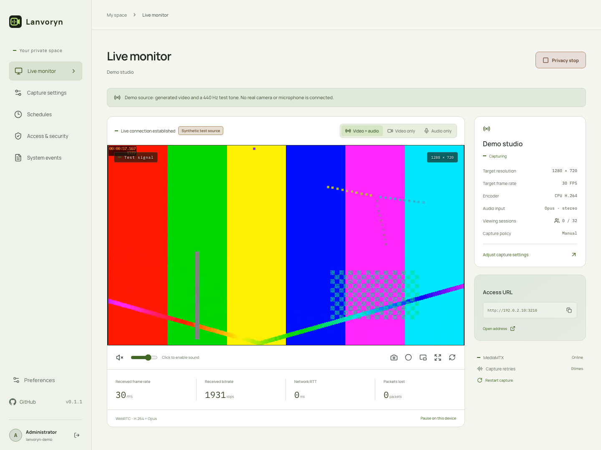

# Lanvoryn

Self-hosted, real-time camera and microphone streaming for your local network.

Connect a camera and microphone to a Linux host, then watch and listen from a phone, tablet or computer in a browser. Choose video, audio or both, with password-protected access and no cloud account.



*Local demo with generated video and audio. The hostname and address shown are examples.*

## Features

- **Live audio and video:** browser playback over WebRTC, with video-only, audio-only and combined modes.
- **Devices free when idle:** capture starts on demand and stops when the last player leaves. Only inputs needed by active players are opened; video-only playback does not request the microphone.
- **Device and quality controls:** select a camera and microphone independently; adjust supported resolution, frame rate, encoding, bitrates, audio gain, filters and synchronization.
- **Private access:** separate administrator and read-only guest access, revocable sessions, and a privacy stop that releases devices and disconnects viewers.
- **Viewing schedules:** manual, continuous or weekly availability, including overnight windows and time zones. Devices stay free when nobody is playing.
- **Playback tools:** snapshots, browser-local recording, stream statistics and automatic reconnection; configuration import/export and event logs.

## Quick start

The capture host needs **Linux, Node.js 24+, npm, FFmpeg, `v4l-utils` and `alsa-utils`**, plus permission to access the selected devices. Viewing devices only need a compatible browser. For startup at boot, follow the [systemd deployment guide](docs/DEPLOYMENT.md).

```bash
git clone https://github.com/Snake-Konginchrist/lanvoryn.git
cd lanvoryn
npm ci
npm run setup
```

Setup creates your web administrator account and copies `.env.example` to `.env` if it does not exist. Choose a username and a password of 12–128 characters in the terminal; there is no default password.

Edit `.env` and set the media host to the Linux host's LAN IP, reachable by your viewing devices. For example:

```dotenv
LANVORYN_SOURCE=linux
LANVORYN_MEDIA_HOST=192.168.1.50
```

For a local demo without capture hardware, explicitly use `LANVORYN_SOURCE=demo`. It generates test video and a 440 Hz tone; device failures never silently switch to a demo.

```bash
npm run media:install
npm run media:config
npm run build
```

Start MediaMTX in one terminal:

```bash
npm run media:start
```

Start the application in another terminal, from the same project directory:

```bash
npm start
```

Open `http://192.168.1.50:3210` using your host's actual LAN IP. Sign in, choose your devices in **Capture settings**, save, then return to **Live monitor** and click **Start capture**. This enables viewing; devices are opened only while a player needs them. Click **Enable sound** to hear audio if the browser requires it.

Allow **3210/TCP** for the web application and **8189/UDP and TCP** for WebRTC media. Keep internal media and management ports private. Use HTTPS on shared or untrusted networks because HTTP does not encrypt login data.

## Documentation

- [Linux and systemd deployment](docs/DEPLOYMENT.md)
- [Configuration and troubleshooting](docs/CONFIGURATION.md)
- [Architecture and access boundaries](docs/ARCHITECTURE.md)
- [Technology choices and dependency policy](docs/RESEARCH.md)
- [Verification scope](docs/VERIFICATION.md)

## Development and contributing

React, TypeScript and Vite provide the interface; Fastify serves the application and APIs. FFmpeg encodes H.264/Opus, and MediaMTX delivers media through WebRTC/WHEP. The repository uses npm workspaces, with tested dependencies recorded in `package-lock.json`.

```bash
npm run dev
npm run check
npm run lint
npm test
npm run build
```

For contribution guidelines and browser test setup, see [Contributing](CONTRIBUTING.md). Report vulnerabilities through the [security policy](SECURITY.md).

## License

[MIT](LICENSE). Upstream software retains its own licenses.

---

Documentation: **English** | [Simplified Chinese](README.zh-CN.md)
