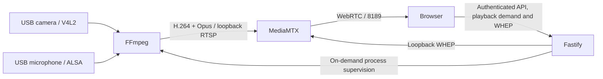

# Architecture

**English** · [简体中文](ARCHITECTURE.zh-CN.md)

Fastify serves the production React application and same-origin APIs. Browsers receive media through RTCPeerConnection and WHEP; they never need to grant access to their own camera or microphone.

`packages/shared` defines validated settings, DTOs and weekly scheduling. Server modules separate authentication, playback demand (`playback-demand.ts` / `playback.ts`), capture supervision, FFmpeg argument construction, device inspection, WHEP session ownership and persistence. Local JSON resources supply eight UI languages through i18next.

MediaMTX routes media; it does not automatically convert MJPEG to H.264. FFmpeg captures the requested inputs in one process and performs video/audio encoding. Opus output is 48 kHz, independently of the selected input sample rate. Viewers share capture and encoding, while each media connection consumes network bandwidth.

## On-demand capture

Viewing availability and device use are separate. The saved manual, continuous or scheduled policy determines whether playback is allowed. Within an allowed period, the server opens only enabled inputs requested by active players. Audio-only playback does not request a camera; video-only playback does not request a microphone. Other players may still need those inputs.

Each player renews an authenticated playback lease every ten seconds. Pausing, leaving the live page, hiding the page or closing it removes that player's demand; an explicit browser-local recording may continue in the background. Leases expire 30 seconds after their last heartbeat, and a two-second server loop reclaims abandoned demand. Capture stops when no requested inputs remain. Changing the combined input set restarts the shared FFmpeg process and can briefly reconnect other players.

Browser mute controls local output only and does not release an audio request. Privacy stop clears playback demand, stops capture and disconnects viewers.

## Access boundary

Administrators change settings, schedules and credentials; guests can only inspect status and watch/listen. Credentials require local setup, have no default password, and use salted scrypt hashes. Opaque in-memory sessions are carried by HttpOnly / SameSite=Strict cookies. Restarting the application invalidates all logins. Only language and theme preferences go into localStorage.

Raw RTSP, WHEP and management listeners bind to loopback. MediaMTX internal permissions also restrict source IPs to loopback. External clients must pass Lanvoryn authentication before negotiating a media session. The media port is not an anonymous player and uses WebRTC session keys. The host OS and local users are trusted; this is not an isolation mechanism between local system accounts.

WHEP sessions are associated with login sessions and removed on logout, expiry, password change or revocation. Configuration writes are serialized and atomic, with revision conflict checks. Device commands run as argument arrays without a shell; clients cannot provide arbitrary commands, filters or publishing URLs.

## Scheduling

A window belongs to its start weekday. Monday 22:00–06:00 ends on Tuesday. Starts are inclusive, ends exclusive, and overlapping windows form a union. Every two seconds, the application evaluates the current wall-clock time in the saved IANA time zone. Restart, clock and daylight-saving changes cause reevaluation; historical events are not replayed.

Manual start/stop selects manual mode. This prevents a privacy stop from immediately being undone by a schedule. Restore scheduled mode explicitly to resume it. An empty schedule blocks playback. Schedules control viewing availability, not server power, and never keep idle devices open.

## Scope

This release supports one Linux host, one configured camera/microphone pair and one application process, shared by multiple viewers. It does not provide independent streams from several cameras at once. Browser recordings and snapshots remain on the viewing device. There is no continuous server recording, retention policy, two-way talk, cloud redistribution or multi-tenant account system.

Network RTT is not end-to-end playback latency. Camera throughput, encoding delay, synchronization and target-browser compatibility require real hardware acceptance; synthetic tests cannot establish those results.
