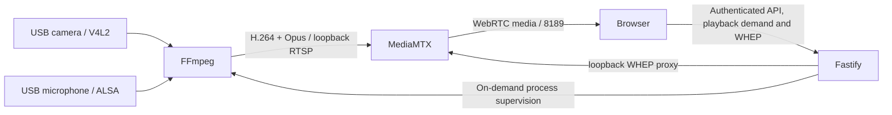

# 架构与边界

[English](ARCHITECTURE.md) · **简体中文**

前端是 React/Vite 单页应用，生产环境由 Fastify 提供静态文件。同源接口避免复杂的跨域凭据配置。播放器使用标准 RTCPeerConnection + WHEP；浏览器只接收媒体，不调用用户设备的摄像头或麦克风。

## 模块

- `packages/shared`：Zod 参数约束、默认设置、DTO 和周计划算法。
- `apps/server/src/auth.ts`：密码验证与内存会话；服务重启后必须重新登录。
- `playback-demand.ts` / `playback.ts`：按登录会话登记播放需求、续期与回收。
- `capture.ts` / `ffmpeg.ts`：单个 FFmpeg 进程、参数数组、退避重试和主动停止。
- `webrtc.ts`：对每个登录会话登记 WHEP 连接，注销、密码变更、撤销或到期时删除对应媒体会话。
- `devices.ts`：V4L2 / ALSA 枚举和受验证的硬件控制。
- `apps/web/src/locales`：八种语言的本地资源，不依赖在线翻译。

MediaMTX 负责媒体路由，不负责把 MJPEG 自动转成 H.264。FFmpeg 在单个进程中采集所需输入并编码；音频输入采样率可配置，Opus 发布输出统一为 48 kHz。多个观看者共享采集和编码，但每个观看连接都会增加网络带宽。

## 按需采集

开放观看与占用设备分开处理：保存的手动、持续或定时策略决定是否允许播放；允许播放时，服务器只打开已启用且被当前观看者请求的输入。仅音频不会请求摄像头，仅视频不会请求麦克风；其他观看者仍可能需要这些输入。

每个播放器每 10 秒续期一次经过认证的播放租约。暂停、离开播放页、隐藏或关闭网页会撤销该播放器的需求，主动开启的浏览器本地录制可在后台继续。租约在最后一次心跳后 30 秒到期，服务器每 2 秒回收遗留需求；没有所需输入时停止采集。合并后的输入组合变化会重启共享的 FFmpeg 进程，其他观看者可能短暂重连。

浏览器静音只控制本地输出，不撤销音频请求。“隐私停止”会清空播放需求、停止采集并断开观看者。

## 权限

管理员可设置设备、参数、计划和密码；访客仅能读取运行状态并观看。账号由本地交互设置，没有默认密码。密码使用独立随机盐的 scrypt，令牌放 HttpOnly / SameSite=Strict Cookie，不进入 localStorage；localStorage 仅记录语言与主题偏好。

MediaMTX 的信令、管理和 RTSP 只绑定回环地址，内部用户也只允许回环源 IP。外部客户端必须通过 Lanvoryn 认证后才能取得 WebRTC 协商结果。8189 是媒体端口，不是匿名播放网页；媒体使用 WebRTC 的会话密钥。信任本机 OS 和本机用户，不能把这个边界当成本机多用户隔离。

配置写入使用临时文件与原子 rename，带递增 revision，防止多个控制台悄悄覆盖。修改请求串行执行。FFmpeg 与 v4l2-ctl 使用 `execFile`/`spawn` 参数数组，禁用 shell，不接受客户端提交的自定义命令、滤镜表达式或发布 URL。

## 定时语义

每个每周窗口归属于开始日；`22:00–06:00` 表示到次日 06:00。开始包含、结束不包含；重叠窗口取并集。基于指定 IANA 时区的当前墙上时间判断，每 2 秒重新计算一次。重启、时钟调整和夏令时变化后重新求当前状态，不补执行错过的历史任务。不存在的本地时刻按实际时区跳变处理，重复时段按当地当前时间判断。

手动开始/停止会切换到手动策略，避免计划下一秒把隐私停止重新打开。想恢复计划，需要重新选择“按计划开放”并保存。空计划禁止播放。计划控制可观看的时段，不控制服务器电源，无人播放时不会持续占用设备。

## 限制

当前支持单台 Linux 主机、配置的一组摄像头与麦克风、单个应用进程，供多个观看者共享；不提供多路摄像头同时独立串流。浏览器截图和录制保存在观看设备，服务器没有持续录制和保留策略，也不提供双向对讲、云端分发或多租户账号系统。

不保证固定端到端延迟、任意分辨率性能或所有浏览器硬件解码能力。显示的 RTT 是网络往返时间，不是音视频从现场到屏幕的延迟。字幕、声纹识别、云端分发、双向对讲和无人值守远程升级不在此版本范围。
